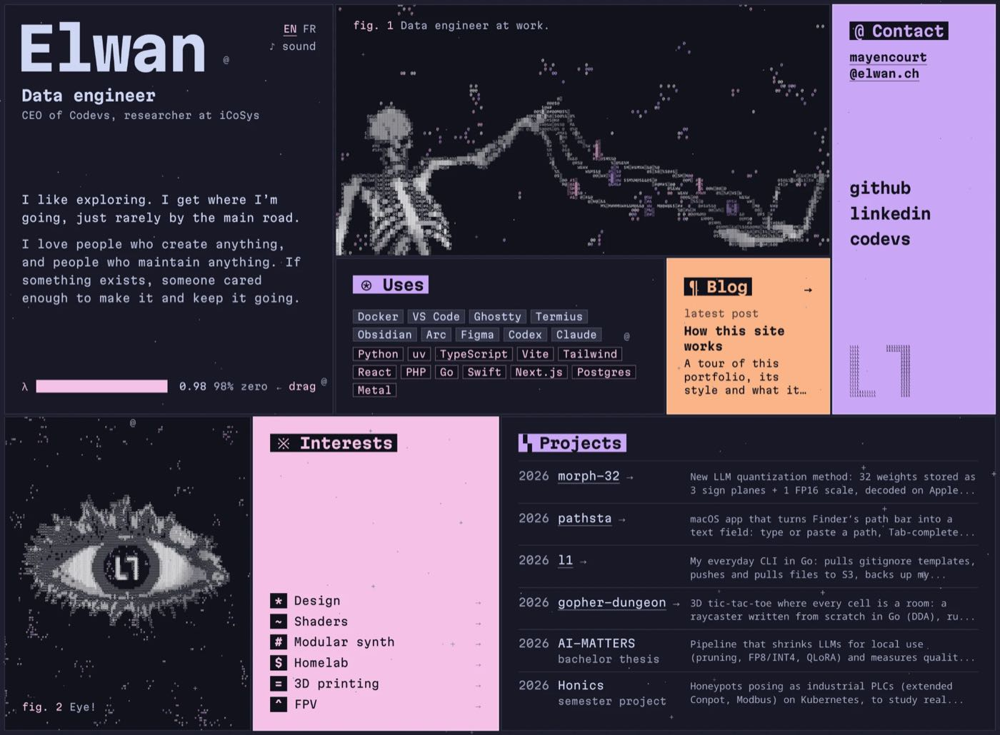

# Portfolio



This repo contains the code for my portfolio at [elwan.ch](https://elwan.ch). It is a single page
except for the blog and is available in English and French. Everything on the page is drawn as
text and the content comes from a MySQL database.

The site also has an admin part behind a login. It manages a todo board and generates the SVG
cards I use in my GitHub README.

## Art style

There are no images. Every picture is real text in a monospace font.

- Each picture is a grid of glyphs from light to dense: `▒ % $ # M W @ ▓ █`
- The colors come from Catppuccin Mocha: white, mauve and pink
- The art starts hidden in a wall of random glyphs. Drag the λ slider toward zero and the wall
  wipes away
- The sound button plays a track by Xav. Bass hits make the art glitch
- The cursor leaves a trail of glitching letters
- Art is stored in a compact text format in `assets/art`. `pnpm art` turns generator output
  into that format

## Run

You need Node 24 or newer, pnpm 11 and Docker.

```bash
cp .env.example .env
pnpm install
pnpm db:up
pnpm db:migrate
pnpm db:seed
pnpm dev
```

Open http://localhost:2828. The seed fills the database with the content.

For production run `pnpm build` and then `pnpm start`. It listens on port 2828 too.

## Commands

| Command          | What it does                 |
| ---------------- | ---------------------------- |
| `pnpm dev`       | Dev server                   |
| `pnpm build`     | Production build             |
| `pnpm start`     | Run the build                |
| `pnpm check`     | Format, lint and type checks |
| `pnpm db:studio` | Browse the database          |

## Built with

[](https://tanstack.com/start)
[](https://vite.dev)
[](https://nitro.build)
[](https://react.dev)
[](https://www.typescriptlang.org)
[](https://tailwindcss.com)
[](https://www.prisma.io)
[](https://www.mysql.com)

## Deploy

Push a tag like `v4.0.2`. GitHub Actions copies the build to the server over SSH and publishes a
GitHub release from `CHANGELOG.md`.

## Why TanStack Start instead of Next.js

The site started on Next.js 16 (App Router). It moved to TanStack Start in October 2026 to
get a smaller bundle and a simpler stack. Both versions render the same page from the same DB.

### Measured difference

Same machine (Apple M5 Pro, 18 cores, Node 26), production build, page `/en`, medians of 5
Lighthouse runs, builds averaged over 3 clean runs, load test 10 connections for 10 s with
autocannon. Machine load was 2.6 for Next.js and 3.3 for TanStack Start.

| Metric                        | Next.js 16 | TanStack Start | Change |
| ----------------------------- | ---------- | -------------- | ------ |
| JS over the wire              | 171 KB     | 120 KB         | -30%   |
| HTML document                 | 18 KB      | 6.3 KB         | -65%   |
| Total transfer                | 227 KB     | 162 KB         | -29%   |
| Client JS on disk (gzip)      | 207 KB     | 155 KB         | -25%   |
| Clean build                   | 2536 ms    | 1445 ms        | -43%   |
| Dev cold start                | 1957 ms    | 1468 ms        | -25%   |
| Dev warm request              | 53 ms      | 14 ms          | -74%   |
| Dev server memory             | 1238 MB    | 765 MB         | -38%   |
| Production server memory      | 639 MB     | 554 MB         | -13%   |
| TTFB median                   | 6.8 ms     | 4.1 ms         | -41%   |
| Load throughput               | 308 req/s  | 1234 req/s     | 4x     |
| Load latency p99              | 42 ms      | 17 ms          | -60%   |
| Mobile LCP                    | 2508 ms    | 2165 ms        | -14%   |
| Mobile TBT                    | 58 ms      | 24 ms          | -59%   |
| Mobile first contentful paint | 1054 ms    | 1803 ms        | +71%   |
| Lighthouse score, mobile      | 77         | 77             | same   |
| Lighthouse score, desktop     | 100        | 100            | same   |
